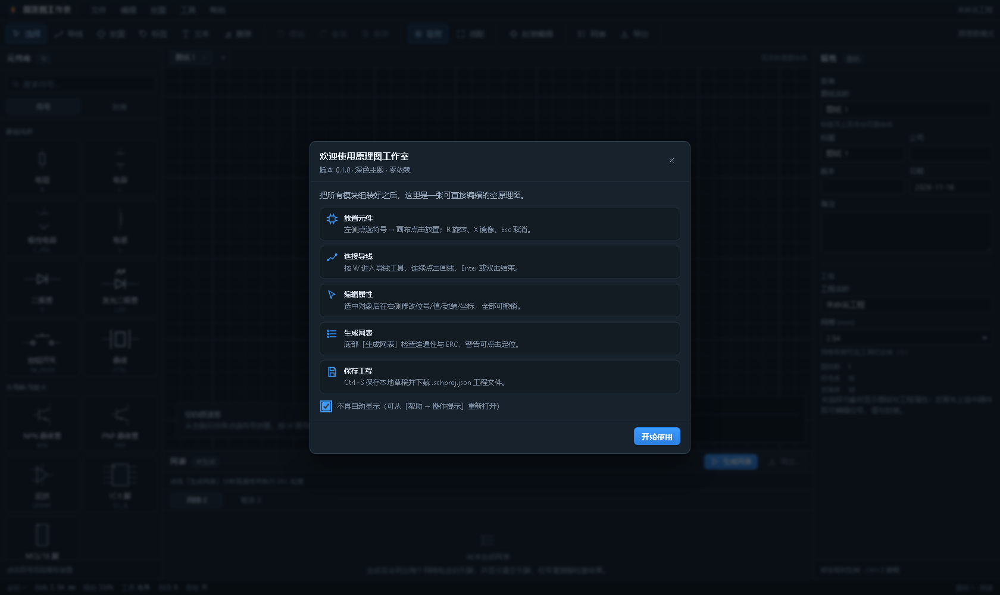

# 原理图工作室（schematic-studio）

一个零依赖、零构建的浏览器端原理图编辑器：纯 HTML / CSS / 原生 ES Modules 实现，
自带小型静态服务器，现代 Chrome / Edge 打开即用。支持原理图绘制与编辑、符号/封装库、
封装绘制、连通性分析与 ERC、JSON / CSV / KiCad 9 / Protel 网表导出、KiCad 9 网表导入
（含 net class 展示）、SVG / PNG 导出、工程保存与完整撤销重做。



## 功能概览

- **原理图绘制与编辑**：符号放置（R 旋转 / X 镜像）、连续画线并吸附端点、自动结点、标签与文本、点选 / 框选 / 拖动 / 删除、网格吸附、完整撤销重做。
- **符号库**：18 个内置符号（电阻、电容、电感、二极管、LED、NPN/PNP、GND/VCC/+5V 电源、按钮、晶振、运放、IC_8、MCU_16、2/4 脚连接器），支持搜索与分类。
- **封装库与封装绘制**：10 个内置封装（0402/0603/0805、SOT-23、SOIC-8、DIP-8、排针、QFP-32），封装编辑器支持焊盘与丝印/Courtyard 绘制、图层配色与编号管理。
- **连通性分析与网表导出**：按导线、引脚、结点、全局/局部标签与电源符号推导网络（命名优先级：电源名 > 全局标签 > 局部标签 > `N$n`），提供 6 类 ERC 检查，导出 JSON / CSV / **KiCad 9 (version E) 完整网表** / Protel(PCBNEW) 四种格式；KiCad 网表含 `design`（每图纸 `title_block` + 9 槽 comment）、`components`（`fields`/`libsource`/`property`/`sheetpath`）、`libparts`、`libraries` 与 `nets`（`class` + `pintype`/`pinfunction`）六个分节。
- **KiCad 网表导入**：读取 KiCad 9 的 `.net`（`(export (version "E") …)`），重建工程库符号、多图纸归属、net class 与连通性（每引脚 stub 导线 + 同名网络标签），导入后可继续编辑并原样再导出（`examples/tinytapeout-demo.net` 导入再导出与源文件逐字节相同）。
- **net class 展示**：网表面板每个网络行显示 KiCad 网络类徽标（`Default` / `pwr` / `clk` 等），导入工程的 class 随 KiCad 网表往返保留。
- **导出**：SVG 矢量图（纯函数，不依赖 canvas）与 PNG 位图（2 倍分辨率）。
- **工程持久化**：`.schproj.json` 保存 / 打开（严格 schema 校验并列出错误路径）、localStorage 本地草稿与恢复。
- **示例工程**：LED 指示灯、MCU 最小系统，从「文件 → 打开示例」一键载入。

## 快速开始

```bash
node server.mjs      # 或 npm start
```

浏览器打开 <http://127.0.0.1:8080>（服务器默认只监听本机；`PORT` 可改端口，`HOST=0.0.0.0` 可放开局域网）。无需 `npm install`。
首次启动可点击「开始使用」，然后通过「文件 → 打开示例：LED 指示灯」立即看到一张完整电路；
完整操作步骤、快捷键、网表格式与 FAQ 见 **[docs/USAGE.md](docs/USAGE.md)**。

用真实 KiCad 网表验证导入 / 导出（3 步，仓库自带 150 元件的 KiCad 9.0.8 样本）：

1. 启动后选「文件 → 导入 KiCad 网表…」，选择 `examples/tinytapeout-demo.net`；提示「已导入 KiCad 网表：元件 150 · 网络 114 · 图纸 2」，标签页出现 `Root` 与 `RP2040` 两张图纸。
2. 点底部「生成网表」查看网络与 net class（统计为 网络 113 · 引脚 583 · 元件 150 · 警告 5；网络行右侧显示 `Default` / `pwr` / `clk` 等 9 类徽标）。
3. `Ctrl+E` → 选「KiCad 9 (version E)」→「下载文件」，再与源文件对比：114 个网络名、584 个引脚节点与 net class 完全一致，再导出的文件与 KiCad 原文件逐字节相同（254285 字节、SHA-256 `2f92e581…a53f`；命令与实测输出见 [docs/USAGE.md 第 8.3 节](docs/USAGE.md#83-完整走查导入-tinytapeout-demonet-并对比导出结果)）。

## 功能矩阵

| 能力 | 说明 | 关键实现 | 对应测试 |
| --- | --- | --- | --- |
| 原理图绘制与编辑 | 放置/旋转/镜像符号、连续画线与端点吸附、自动结点、选择框选拖动、撤销重做 | `src/editor/**`、`src/model/store.js` | `test/editor/*.test.mjs` |
| 符号库 | 18 个内置符号；`createSymbolLibrary` 检索、序列化与深拷贝 | `src/library/builtin-symbols.js`、`src/library/symbol-library.js` | `test/library/*.test.mjs` |
| 封装库与封装绘制 | 10 个内置封装；焊盘/图形编辑、图层、编号递增、保存到工程库 | `src/library/builtin-footprints.js`、`src/editor/footprint-*.js`、`src/render/footprint-renderer.js` | `test/library/*`、`test/editor/footprint-*.test.mjs` |
| 连通性分析与 ERC | 并查集合并引脚/导线/结点/标签/电源；悬空引脚、单脚网络、重复位号、缺封装、未连接导线、电源冲突 6 类检查 | `src/netlist/connectivity.js`、`src/netlist/erc.js` | `test/netlist/connectivity.test.mjs`、`test/netlist/erc.test.mjs` |
| 网表导出 | JSON / CSV / KiCad 9 (version E) / Protel(PCBNEW) 四种格式，含预览、复制与下载；KiCad 网表分六节、CRLF 无 BOM、末尾无换行 | `src/netlist/index.js`、`src/netlist/kicad-format.js`、`src/ui/dialogs/export-dialog.js` | `test/netlist/exporters.test.mjs`、`test/netlist/kicad-exporter.test.mjs` |
| KiCad 网表导入 | 解析 `(export (version "E") …)`，重建库符号 / 多图纸 / net class / 连通性（stub 导线 + 网络标签），失败只报错不改工程 | `src/netlist/kicad-reader.js`、`src/netlist/kicad-import.js`、`src/ui/file-actions.js` | `test/netlist/kicad-reader.test.mjs`、`test/netlist/kicad-import.test.mjs`、`test/integration/kicad-roundtrip.test.mjs` |
| 图形导出 | SVG（纯函数、复用渲染图元与主题）、PNG（2 倍分辨率、画布尺寸可恢复） | `src/io/svg-export.js`、`src/io/svg-primitives.js`、`src/io/png-export.js` | `test/io/svg-export.test.mjs`、`test/io/png-export.test.mjs` |
| 工程持久化 | 序列化/反序列化、schema 校验与 warnings、localStorage 草稿、浏览器下载 | `src/io/project-io.js`、`src/core/schema.js` | `test/io/project-io.test.mjs`、`test/core/schema.test.mjs` |
| 界面与交互 | 菜单/工具栏/面板/对话框/快捷键/多图纸/封装模式/首次提示；网表面板显示 net class 徽标 | `src/ui/**` | `test/ui/*.test.mjs` |
| 示例工程 | LED 示例（VCC/N$1/GND）、MCU 示例（+5V/GND/XTAL 等）与 KiCad 9 网表黄金样本（150 元件 / 114 网络 / 2 图纸） | `examples/demo-led.json`、`examples/demo-mcu.json`、`examples/tinytapeout-demo.net` | 见 `docs/USAGE.md` 第 11 节（集成任务覆盖）与 `test/integration/kicad-roundtrip.test.mjs` |

## 架构

分层单向依赖（只能向下 import，禁止反向依赖），各层目录均位于 `src/`：

```text
ui            DOM 装配、面板、快捷键、样式
 |
 v
io            工程序列化 / SVG / PNG 导出
 |
 v
editor        工具、可撤销命令、编辑器、吸附
 |
 v
netlist / render   连通性分析与网表；视图变换与 Canvas 渲染
 |
 v
model / library    工程数据与状态仓库；符号库与封装库
 |
 v
core          ID、几何、事件总线、命令栈、schema
```

详细分层规则、目录约定与架构决策记录（ADR）见 **[docs/ARCHITECTURE.md](docs/ARCHITECTURE.md)**；
全队唯一权威接口契约见 **[docs/CONTRACTS.md](docs/CONTRACTS.md)**。

### 开发约定

- 纯原生 HTML / CSS / ES Modules；**零第三方依赖、零 CDN、零构建步骤**。
- **单根布局**：可运行代码全部位于 `src/`（`core` / `model` / `library` / `netlist` / `render` / `editor` / `io` / `ui` 为层目录），入口是 `src/main.js`，测试在 `test/<层>/` 并镜像 `src/`。
- 分层单向依赖：`src/core -> (src/model | src/library) -> (src/netlist | src/render) -> src/editor -> src/io -> src/ui`，禁止反向 import。
- 纯函数层（`src/core`、`src/model`、`src/library`、`src/netlist`、`src/render` 的纯函数模块与 `src/io` 序列化）禁止依赖 DOM，便于 `node --test` 直接测试。
- 代码风格：2 空格缩进、分号结尾、单引号、文件与目录 kebab-case、每个文件顶部一句职责注释。

## 目录结构

```text
sch/
├── index.html              # 应用外壳
├── server.mjs              # 零依赖静态服务器（导出 createServer 供测试）
├── package.json            # 无依赖，scripts: start / test / smoke / verify:browser
├── .gitattributes          # 统一 LF 换行（`*.net` 例外：保留 KiCad 原始 CRLF 字节）
├── src/
│   ├── main.js             # bootstrap(root) 启动入口
│   ├── core/               # ID、几何、事件总线、命令栈、schema
│   ├── model/              # 工程数据与纯函数、状态仓库
│   ├── library/            # 符号库与封装库（含内置数据）
│   ├── netlist/            # 连通性分析、ERC、KiCad 9 网表读写与四种网表导出
│   ├── render/             # 视图变换、画布渲染、主题、网格、符号绘制
│   ├── editor/             # 吸附、可撤销命令、编辑器与工具
│   ├── io/                 # 工程序列化、SVG / PNG 导出
│   └── ui/                 # 菜单/工具栏/面板/对话框/样式，含示例入口
├── examples/
│   ├── demo-led.json       # LED 示例（VCC → 220R → LED → GND）
│   ├── demo-mcu.json       # MCU 最小系统示例
│   └── tinytapeout-demo.net # KiCad 9.0.8 导出的网表黄金样本（导入 / 往返测试夹具）
├── docs/
│   ├── ARCHITECTURE.md     # 分层架构与 ADR
│   ├── CONTRACTS.md        # 接口契约（唯一权威）
│   ├── USAGE.md            # 使用教程（含截图、网表导入导出走查与 FAQ）
│   ├── NETLIST_KICAD_SPEC.md # KiCad 9 网表格式规范与数据契约
│   ├── REVIEW.md           # 代码评审报告（发现 / 修复 / 指标）
│   ├── FINAL_CHECKLIST.md  # 最终交付清单（功能矩阵与复验证据）
│   ├── images/             # 界面截图
│   └── review/             # 评审与验证证据（CJK 前后对比、浏览器主流程截图/装配页）
├── scripts/
│   ├── smoke.mjs           # npm run smoke：随机端口静态资源冒烟
│   └── browser-flow.mjs    # npm run verify:browser：headless Chrome 主流程验证
└── test/                   # node:test 用例（镜像 src/ 的层目录）
```

## 运行与测试

```bash
node server.mjs        # 启动静态服务器，默认仅监听 127.0.0.1:8080
npm test               # 等价 node --test，运行 test/ 下全部用例
npm run smoke          # 启动随机端口服务器并冒烟请求全部静态资源
npm run verify:browser # headless Chrome 跑真实主流程（需本机 Chrome/Edge）
```

- 运行环境：Node.js 22+（使用内置 `node:test` 与 JSON 模块动态导入）；浏览器需现代 Chrome / Edge（支持 JSON 模块动态导入，约 123+）。旧版浏览器仍可启动编辑器，打开示例时会在对话框提示升级。
- 默认只监听回环地址；需要在局域网访问时显式放开：`HOST=0.0.0.0 node server.mjs` 或 `node server.mjs --host 0.0.0.0`。以点开头的路径段（`.git`、`.agent-teams`、`.env` 等）一律返回 404。
- 全部用例 `npm test` 全绿（本文档实测 496 个，随功能分支合并会继续增长）；纯逻辑层（core/model/library/netlist/render 的纯函数/io 序列化）不依赖 DOM，可直接在 Node 中测试。KiCad 网表另有「解析 → 重建 → 再导出」语义往返测试（`test/integration/kicad-roundtrip.test.mjs`：114 网络 / 584 节点 / net class 逐项比对，黄金样本再导出与源文件逐字节相同、二次往返为不动点）。
- 服务器冒烟：`npm run smoke` 通过 **94/94** 项资源检查（含首页、样式、全部 `src/` 模块、示例 JSON 与网表夹具）。
- 浏览器主流程：`npm run verify:browser` 通过 **12/12**（示例加载、网表、SVG/KiCad/CSV 导出、放置/连线/junction、改位号值封装、撤销、封装焊盘），控制台 0 错误；完整证据见 **[docs/FINAL_CHECKLIST.md](docs/FINAL_CHECKLIST.md)**。

## Git 规范

- conventional commits：`<type>(<scope>): <简述>`（feat / fix / test / docs / chore / refactor），一个提交只做一件事。
- 只暂存自己负责的路径；禁止 `git add -A`、`--amend`、`rebase`、`reset --hard`、切分支与 push。
- 提交前运行 `npm test`；URL 与临时文件不进入仓库。

## 已知限制

- 连接判断基于几何重合（容差 1e-6 mm），不包含总线、层次化图纸、差分对等高级概念；导线交叉但未落结点不会误连。
- 撤销采用整工程快照（命令 `do/undo` 深拷贝），超大工程会随历史深度增加内存占用；可通过 `CommandStack` 的 `maxDepth` 限制。
- ERC 只覆盖 6 类基础检查，不做电气规则全量校验（如驱动能力、扇出、时序）。
- 封装编辑器支持焊盘与基本图形，不含 3D 预览、封装 DRC 或自动布线。
- SVG 导出标题栏为简化排版；PNG 依赖 Canvas，导出分辨率为固定 2 倍。
- 示例数据通过动态 `import()` 按需加载 JSON 模块；不支持 JSON 模块的旧浏览器不会白屏，仅「打开示例」时提示升级。
- 工程草稿只保存一份（localStorage key `schematic-studio:draft`），不支持云端同步或多工程库。
- `src/ui/panels/properties-panel.js`（891 行）与 `src/netlist/connectivity.js`（749 行）本轮保留：拆分需配套 UI/算法回归测试，风险高于收益；后续方案（`property-forms/`、`union-find.js` + `naming.js`）见 FINAL_CHECKLIST 第 8 节。
- 浏览器端到端脚本 `npm run verify:browser` 依赖本机 Chrome/Edge（可用 `CHROME_PATH` 指定），不纳入 `npm test` 的默认步骤。
- 默认 4 px/mm 视图下 1.27 mm 文本仅约 5 CSS px：渲染已不再重叠，但阅读小字需放大或改用 2.54 mm 字号。
- KiCad 网表导入只重建电气语义：网表不含坐标、旋转与图形，元件按 2.54 mm 网格摆放、符号渲染为统一矩形（引脚名/号/电气类型保留），不还原 KiCad 的版图与图形细节。
- 网表往返以黄金样本为基准：`examples/tinytapeout-demo.net` 导入再导出与源文件逐字节相同（254285 字节、SHA-256 `2f92e581…a53f`、0 行差异），由 `test/integration/kicad-roundtrip.test.mjs` 在 `npm test` 中自动保障。
- PCB 布局未实现。
