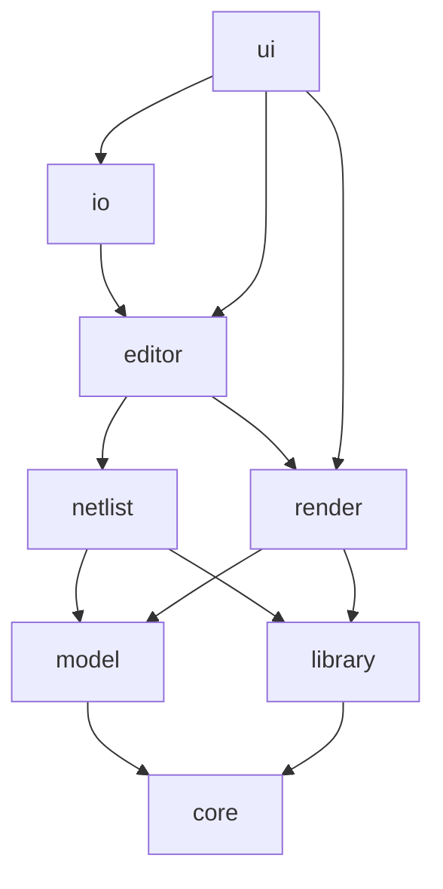

# 架构说明

本文描述「原理图工作室」的分层结构、目录约定、编码风格与协作流程。
接口签名以 [CONTRACTS.md](./CONTRACTS.md) 为唯一权威，本文只解释分层与约束。

## 1. 设计目标

- **零依赖、零构建**：纯原生 HTML / CSS / ES Modules，直接由 `node server.mjs` 提供静态文件，现代 Chrome / Edge 打开即用。
- **高内聚低耦合**：数据模型、几何、连接性分析、渲染、编辑器、导入导出、UI 各自独立成层，单向依赖。
- **可测试**：所有纯逻辑模块不触碰 DOM，可直接被 `node --test` 加载。
- **可扩展**：新增符号、封装、导出格式或工具时，只改动对应层，不牵动其他层。

## 2. 分层依赖图（单向）

依赖方向只能自上而下（箭头指向被依赖方），禁止反向 import。

```text
        ui            （DOM 装配、面板、快捷键、样式）
         |
         v
        io            （工程序列化、SVG / PNG 导出）
         |
         v
      editor          （工具、可撤销命令、编辑器控制器、吸附）
         |
         v
   netlist / render    （连通性分析、网表导出；视图变换、画布渲染）
         |
         v
   model / library     （工程数据与纯函数、状态仓库、符号库、封装库）
         |
         v
        core           （id、几何、事件总线、命令栈、schema 校验）
```



补充规则：

| 层 | 可依赖 | 禁止依赖 |
| --- | --- | --- |
| `core` | 仅标准库（无 DOM） | 其余所有层 |
| `model` / `library` | `core` | `netlist`、`render`、`editor`、`io`、`ui` |
| `netlist` | `core`、`model`、`library` | `render`、`editor`、`io`、`ui` |
| `render` | `core`、`model`、`library` | `editor`、`io`、`ui` |
| `editor` | `core`、`model`、`library`、`render`、`netlist` | `io`、`ui` |
| `io` | `core`、`model`、`library`、`render`、`editor` | `ui` |
| `ui` | 全部下层 | 无（最顶层） |

> 纯函数模块（`core`、`model`、`library`、`netlist`、`render/view.js`、`render/theme.js`、`render/grid.js`、`render/symbols.js`、`io/svg-export.js`、`io/project-io.js`）**禁止**访问 `window`、`document`、`canvas` 等浏览器全局；
> 例外：`render/renderer.js`、`render/footprint-renderer.js`、`io/png-export.js` 允许使用 Canvas / Blob / DOM 二次下载能力。

## 3. 每层职责与禁止事项

### core — 基础设施

- **文件**：`core/id.js`、`core/geometry.js`、`core/event-bus.js`、`core/command.js`、`core/schema.js`
- **职责**：唯一 ID 生成、二维几何纯函数、事件总线、撤销/重做命令栈、工程 schema 版本与校验迁移。
- **禁止**：引入任何业务概念（符号、导线、网表）、访问 DOM、持有全局可变状态、吞掉异常。

### model / library — 数据与库

- **文件**：`model/project.js`、`model/store.js`、`library/symbol-library.js`、`library/builtin-symbols.js`、`library/footprint-library.js`、`library/builtin-footprints.js`
- **职责**：
  - `model/project.js` 定义 Project / Sheet / SymbolInstance / Wire / Junction / Label / Text 等数据结构与纯工厂函数；
  - `model/store.js` 提供应用状态、选区、hover 与撤销栈，`update(mutator)` 是唯一的可撤销修改入口；
  - `library/*` 提供符号与封装的内置数据集与检索库。
- **禁止**：`model/*` 引入 DOM 或渲染代码；`store` 不直接操作 canvas；库模块不得写入工程数据（只读返回副本）。

### netlist / render — 分析与呈现

- **文件**：`netlist/connectivity.js`、`netlist/index.js`、`render/view.js`、`render/renderer.js`、`render/footprint-renderer.js`、`render/theme.js`、`render/grid.js`、`render/symbols.js`
- **职责**：
  - `netlist`：由工程 + 图纸推导网络集合、命名与告警，并按 json / csv / kicad / protel 导出；
  - `render`：世界坐标 ↔ 屏幕坐标变换、网格与图元绘制、主题配色；`render/symbols.js` 同时服务画布与 SVG 导出。
- **禁止**：`netlist` 依赖渲染或 DOM；`render` 修改工程数据、写入 store、触发编辑命令；渲染器不得负责命中测试（命中测试由 editor 决定）。

### editor — 交互与命令

- **文件**：`editor/snapping.js`、`editor/commands.js`、`editor/schematic-editor.js`、`editor/footprint-editor.js`，以及工具模块（`editor/tools/*.js`）
- **职责**：把指针 / 键盘事件翻译成可撤销命令；维护当前工具、吸附锚点、悬浮与选中；驱动渲染刷新。
- **禁止**：直接改写 `project` 对象（必须通过 `store.update` 或命令）；访问 `io` / `ui`；在工具内做文件下载或 DOM 面板更新。

### io — 持久化与导出

- **文件**：`io/project-io.js`、`io/svg-export.js`、`io/png-export.js`
- **职责**：工程 JSON 序列化 / 反序列化、localStorage、文件下载、SVG / PNG 导出。
- **禁止**：依赖 `ui`；`svg-export.js` 依赖 canvas；反序列化失败必须返回 warnings 而不是抛出未捕获异常。

### ui — 装配层

- **文件**：`ui/app.js`、`ui/toolbar.js`、`ui/panels/*.js`、`ui/dialogs/export-dialog.js`、`ui/styles.css`，以及根目录 `index.html`、`src/main.js`
- **职责**：DOM 结构、面板与对话框、快捷键绑定、把 store / library / renderer / editor / io 组装成可运行应用。
- **禁止**：承载业务算法（连通性、几何、网表格式）；直接修改工程数据（走 store / editor）。

## 4. 目录结构

模块目录位于仓库根目录，与契约路径一一对应；`src/main.js` 只做启动引导。

```text
sch/
├── index.html                 # 应用外壳（UI 任务定稿）
├── server.mjs                 # 零依赖静态服务器，导出 createServer
├── package.json               # 无第三方依赖，scripts: start / test
├── src/
│   └── main.js                # bootstrap(root) 入口
├── core/
│   ├── id.js
│   ├── geometry.js
│   ├── event-bus.js
│   ├── command.js
│   └── schema.js
├── model/
│   ├── project.js
│   └── store.js
├── library/
│   ├── symbol-library.js
│   ├── builtin-symbols.js
│   ├── footprint-library.js
│   └── builtin-footprints.js
├── netlist/
│   ├── connectivity.js
│   └── index.js
├── render/
│   ├── view.js
│   ├── renderer.js
│   ├── footprint-renderer.js
│   ├── theme.js
│   ├── grid.js
│   └── symbols.js
├── editor/
│   ├── snapping.js
│   ├── commands.js
│   ├── schematic-editor.js
│   ├── footprint-editor.js
│   └── tools/
├── io/
│   ├── project-io.js
│   ├── svg-export.js
│   └── png-export.js
├── ui/
│   ├── app.js
│   ├── toolbar.js
│   ├── panels/{library,properties,netlist,layers}-panel.js
│   ├── dialogs/export-dialog.js
│   └── styles.css
├── docs/
│   ├── ARCHITECTURE.md
│   └── CONTRACTS.md
└── test/
    ├── scaffold.test.mjs
    └── <module>/*.test.mjs
```

## 5. 命名与代码风格

- **模块系统**：仅用 ES Modules（`import` / `export`），不使用 CommonJS。
- **文件名**：目录与文件使用 kebab-case（`schematic-editor.js`、`builtin-symbols.js`）；测试文件 `<module>.test.mjs`。
- **标识符**：变量 / 函数 camelCase，类 PascalCase，常量 UPPER_SNAKE_CASE。
- **排版**：2 空格缩进、语句以分号结尾、字符串统一单引号（JSON、HTML 属性除外）、行宽尽量 ≤ 110。
- **注释**：每个文件顶部一句职责说明；导出函数写 JSDoc（参数、返回值）；避免无信息量的行内注释。
- **函数**：小而单一，优先纯函数；复杂流程拆成有名字的步骤函数。
- **状态**：禁止全局可变状态；状态集中在 `store`，模块内部状态私有。
- **错误处理**：显式返回结果（`{ ok, errors } / { project, warnings }`），不吞异常、不静默失败；面向用户的错误由 `ui` 呈现。
- **单位与精度**：世界坐标单位为 mm；旋转角以度为单位；坐标比较使用容差而非严格浮点相等（由各模块自定，几何工具提供）。
- **DOM 边界**：只有 `render/renderer.js`、`render/footprint-renderer.js`、`io/png-export.js`、`ui/**`、`src/main.js` 可以访问浏览器 API。

## 6. 测试策略

- 使用 `node:test` + `node:assert/strict`，通过 `npm test`（等价 `node --test`）运行；无需浏览器与构建步骤。
- 测试目录镜像源码：`test/core/geometry.test.mjs`、`test/model/project.test.mjs`、`test/netlist/connectivity.test.mjs`、`test/io/svg-export.test.mjs` 等；脚手架冒烟测试为 `test/scaffold.test.mjs`。
- **纯逻辑优先**：几何、工程数据、连通性、网表格式、SVG 导出、吸附等必须有单元测试，覆盖正常路径与边界（空图纸、重复网络名、路径穿越等）。
- **Canvas 相关**：为 `CanvasRenderingContext2D` 提供记录型假对象（stub）断言绘制调用序列；`requestAnimationFrame` 可通过注入选项替换为同步实现。
- **严禁**在测试中引入第三方断言库或测试框架。
- 提交前必须保证 `npm test` 全绿；不允许用 `skip` 掩盖失败用例。

## 7. Git 提交规范

- 提交前缀使用 conventional commits：`feat` / `fix` / `test` / `docs` / `chore` / `refactor` / `perf`，格式 `<type>(<scope>): <中文或英文简述>`，例如 `feat(netlist): 支持 KiCad 6 网表导出`。
- 一个提交只做一件逻辑上的事；结构搭建、功能实现、文档、测试分别提交；每个任务至少 2 个提交。
- **只** `git add` 自己负责的路径；禁止 `git add -A`、`git commit --amend`、`git rebase`、`git reset --hard`、切换分支、`git push`。
- 提交前先看 `git status` / `git diff`，确认不会带入他人文件或 `.agent-teams/` 内容。
- 遇到 `index.lock` 冲突：`sleep 2` 后重试，最多 5 次。
- 提交信息尽量说明「为什么」，正文可补充影响范围。
