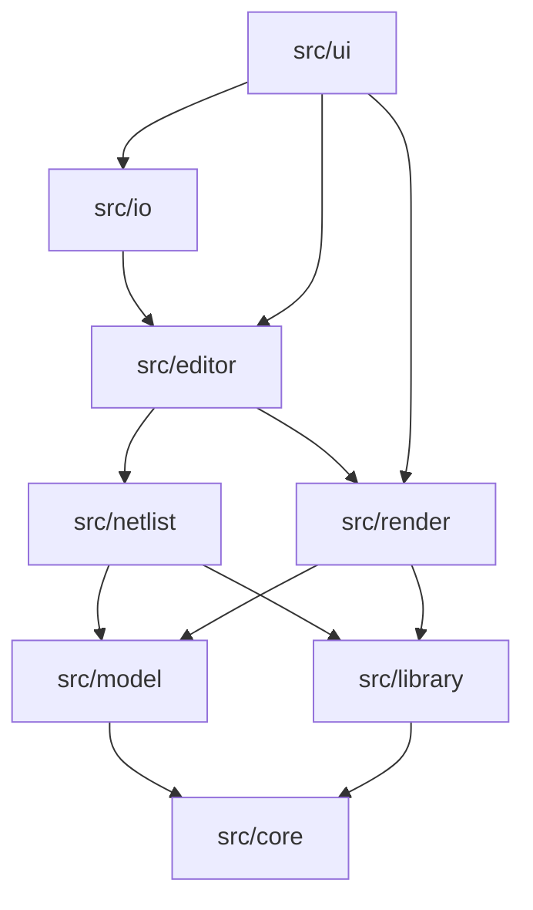

# 架构说明

本文描述「原理图工作室」的分层结构、目录约定、编码风格与协作流程。
接口签名以 [CONTRACTS.md](./CONTRACTS.md) 为唯一权威，本文只解释分层与约束。

## 0. 顶层目录约定

- **单根布局**：所有可运行代码位于 `src/` 下；仓库根目录只保留应用外壳（`index.html`）、零依赖静态服务器（`server.mjs`）、工程配置（`package.json`、`.gitignore`、`.gitattributes`）、文档（`docs/`）与测试（`test/`），没有构建产物目录。
- **层目录**：`src/core/`、`src/model/`、`src/library/`、`src/netlist/`、`src/render/`、`src/editor/`、`src/io/`、`src/ui/`。
- **入口**：`index.html` 通过 `<script type="module" src="./src/main.js">` 加载 `src/main.js`，后者导出并调用 `bootstrap(root)`；除启动引导外，`src/main.js` 不承载业务逻辑。
- **测试**：`test/<层>/<模块>.test.mjs` 与 `src/<层>/<模块>.js` 一一对应（测试目录在仓库根，不放进 `src/`）；脚手架冒烟测试为 `test/scaffold.test.mjs`。
- **跨层相对引用**（显式扩展名，禁止根级绝对路径）：
  - `src/library/symbol-library.js` → `import { uid } from '../core/id.js';`
  - `src/netlist/connectivity.js` → `import { findSheetById } from '../model/project.js';`
  - `src/render/view.js` → `import { clamp } from '../core/geometry.js';`
  - `src/main.js` → `import { startApp } from './ui/app.js';`
- **禁止反向依赖**：只能 `src/core -> (src/model | src/library) -> (src/netlist | src/render) -> src/editor -> src/io -> src/ui`；任何反向 import 都会被纯净性扫描与导入图测试拦截（见 ADR-2、ADR-3）。

## 1. 设计目标

- **零依赖、零构建**：纯原生 HTML / CSS / ES Modules，直接由 `node server.mjs` 提供静态文件，现代 Chrome / Edge 打开即用。
- **高内聚低耦合**：数据模型、几何、连接性分析、渲染、编辑器、导入导出、UI 各自独立成层，单向依赖。
- **可测试**：所有纯逻辑模块不触碰 DOM，可直接被 `node --test` 加载。
- **可扩展**：新增符号、封装、导出格式或工具时，只改动对应层，不牵动其他层。

## 2. 分层依赖图（单向）

依赖方向只能自上而下（箭头指向被依赖方），禁止反向 import；下图与下表均为 `src/` 下的层目录。

```text
       src/ui            （DOM 装配、面板、快捷键、样式）
         |
         v
       src/io            （工程序列化、SVG / PNG 导出）
         |
         v
     src/editor          （工具、可撤销命令、编辑器控制器、吸附）
         |
         v
 src/netlist / src/render（连通性分析、网表导出；视图变换、画布渲染）
         |
         v
 src/model / src/library （工程数据与纯函数、状态仓库、符号库、封装库）
         |
         v
       src/core          （id、几何、事件总线、命令栈、schema 校验）
```



补充规则：

| 层 | 可依赖 | 禁止依赖 |
| --- | --- | --- |
| `src/core` | 仅标准库（无 DOM） | 其余所有层 |
| `src/model` / `src/library` | `src/core` | `src/netlist`、`src/render`、`src/editor`、`src/io`、`src/ui` |
| `src/netlist` | `src/core`、`src/model`、`src/library` | `src/render`、`src/editor`、`src/io`、`src/ui` |
| `src/render` | `src/core`、`src/model`、`src/library` | `src/editor`、`src/io`、`src/ui` |
| `src/editor` | `src/core`、`src/model`、`src/library`、`src/render`、`src/netlist` | `src/io`、`src/ui` |
| `src/io` | `src/core`、`src/model`、`src/library`、`src/render`、`src/editor` | `src/ui` |
| `src/ui` | 全部下层 | 无（最顶层） |

> 纯函数模块（`src/core/*`、`src/model/*`、`src/library/*`、`src/netlist/*`、`src/render/view.js`、`src/render/theme.js`、`src/render/grid.js`、`src/render/symbols.js`、`src/io/svg-export.js`、`src/io/project-io.js`）**禁止**访问 `window`、`document`、`canvas` 等浏览器全局；
> 例外：`src/render/renderer.js`、`src/render/footprint-renderer.js`、`src/io/png-export.js` 允许使用 Canvas / Blob / DOM 二次下载能力。

## 3. 每层职责与禁止事项

### src/core — 基础设施

- **文件**：`src/core/id.js`、`src/core/geometry.js`、`src/core/event-bus.js`、`src/core/command.js`、`src/core/schema.js`
- **职责**：唯一 ID 生成、二维几何纯函数、事件总线、撤销/重做命令栈、工程 schema 版本与校验迁移。
- **禁止**：引入任何业务概念（符号、导线、网表）、访问 DOM、持有全局可变状态、吞掉异常。

### src/model / src/library — 数据与库

- **文件**：`src/model/project.js`、`src/model/store.js`、`src/library/symbol-library.js`、`src/library/builtin-symbols.js`、`src/library/footprint-library.js`、`src/library/builtin-footprints.js`
- **职责**：
  - `src/model/project.js` 定义 Project / Sheet / SymbolInstance / Wire / Junction / Label / Text 等数据结构与纯工厂函数；
  - `src/model/store.js` 提供应用状态、选区、hover 与撤销栈，`update(mutator)` 是唯一的可撤销修改入口；
  - `src/library/*` 提供符号与封装的内置数据集与检索库。
- **禁止**：`src/model/*` 引入 DOM 或渲染代码；`store` 不直接操作 canvas；库模块不得写入工程数据（只读返回副本）。

### src/netlist / src/render — 分析与呈现

- **文件**：`src/netlist/connectivity.js`、`src/netlist/index.js`、`src/render/view.js`、`src/render/renderer.js`、`src/render/footprint-renderer.js`、`src/render/theme.js`、`src/render/grid.js`、`src/render/symbols.js`
- **职责**：
  - `src/netlist`：由工程 + 图纸推导网络集合、命名与告警，并按 json / csv / kicad / protel 导出；
  - `src/render`：世界坐标 ↔ 屏幕坐标变换、网格与图元绘制、主题配色；`src/render/symbols.js` 同时服务画布与 SVG 导出。
- **禁止**：`src/netlist` 依赖渲染或 DOM；`src/render` 修改工程数据、写入 store、触发编辑命令；渲染器不得负责命中测试（命中测试由 editor 决定）。

### src/editor — 交互与命令

- **文件**：`src/editor/snapping.js`、`src/editor/commands.js`、`src/editor/schematic-editor.js`、`src/editor/footprint-editor.js`，以及工具模块（`src/editor/tools/*.js`）
- **职责**：把指针 / 键盘事件翻译成可撤销命令；维护当前工具、吸附锚点、悬浮与选中；驱动渲染刷新。
- **禁止**：直接改写 `project` 对象（必须通过 `store.update` 或命令）；访问 `src/io` / `src/ui`；在工具内做文件下载或 DOM 面板更新。

### src/io — 持久化与导出

- **文件**：`src/io/project-io.js`、`src/io/svg-export.js`、`src/io/png-export.js`
- **职责**：工程 JSON 序列化 / 反序列化、localStorage、文件下载、SVG / PNG 导出。
- **禁止**：依赖 `src/ui`；`src/io/svg-export.js` 依赖 canvas；反序列化失败必须返回 warnings 而不是抛出未捕获异常。

### src/ui — 装配层

- **文件**：`src/ui/app.js`、`src/ui/toolbar.js`、`src/ui/panels/*.js`、`src/ui/dialogs/export-dialog.js`、`src/ui/styles.css`，以及根目录 `index.html`、`src/main.js`
- **职责**：DOM 结构、面板与对话框、快捷键绑定，把 store / library / renderer / editor / io 组装成可运行应用。
- **禁止**：承载业务算法（连通性、几何、网表格式）；直接修改工程数据（走 store / editor）。

## 4. 目录结构

模块目录统一位于 `src/` 下；`src/main.js` 只做启动引导，测试镜像放在仓库根 `test/`。

```text
sch/
├── index.html                 # 应用外壳（UI 任务定稿）
├── server.mjs                 # 零依赖静态服务器，导出 createServer
├── package.json               # 无第三方依赖，scripts: start / test
├── .gitattributes             # 统一 LF 换行
├── .gitignore
├── src/
│   ├── main.js                # bootstrap(root) 启动入口
│   ├── core/
│   │   ├── id.js
│   │   ├── geometry.js
│   │   ├── event-bus.js
│   │   ├── command.js
│   │   └── schema.js
│   ├── model/
│   │   ├── project.js
│   │   └── store.js
│   ├── library/
│   │   ├── symbol-library.js
│   │   ├── builtin-symbols.js
│   │   ├── footprint-library.js
│   │   └── builtin-footprints.js
│   ├── netlist/
│   │   ├── connectivity.js
│   │   └── index.js
│   ├── render/
│   │   ├── view.js
│   │   ├── renderer.js
│   │   ├── footprint-renderer.js
│   │   ├── theme.js
│   │   ├── grid.js
│   │   └── symbols.js
│   ├── editor/
│   │   ├── snapping.js
│   │   ├── commands.js
│   │   ├── schematic-editor.js
│   │   ├── footprint-editor.js
│   │   └── tools/
│   ├── io/
│   │   ├── project-io.js
│   │   ├── svg-export.js
│   │   └── png-export.js
│   └── ui/
│       ├── app.js
│       ├── toolbar.js
│       ├── panels/{library,properties,netlist,layers}-panel.js
│       ├── dialogs/export-dialog.js
│       └── styles.css
├── docs/
│   ├── ARCHITECTURE.md
│   └── CONTRACTS.md
└── test/
    ├── scaffold.test.mjs
    ├── core/*.test.mjs
    ├── model/*.test.mjs
    └── <层>/*.test.mjs
```

## 5. 命名与代码风格

- **模块系统**：仅用 ES Modules（`import` / `export`），不使用 CommonJS。
- **文件名**：目录与文件使用 kebab-case（`schematic-editor.js`、`builtin-symbols.js`）；测试文件 `<module>.test.mjs`。
- **标识符**：变量 / 函数 camelCase，类 PascalCase，常量 UPPER_SNAKE_CASE。
- **排版**：2 空格缩进、语句以分号结尾、字符串统一单引号（JSON、HTML 属性除外）、行宽尽量 ≤ 110。
- **注释**：每个文件顶部一句职责说明；导出函数写 JSDoc（参数、返回值）；避免无信息量的行内注释。
- **函数**：小而单一，优先纯函数；复杂流程拆成有名字的步骤函数。
- **状态**：禁止全局可变状态；状态集中在 `src/model/store.js`，模块内部状态私有。
- **错误处理**：显式返回结果（`{ ok, errors } / { project, warnings }`），不吞异常、不静默失败；面向用户的错误由 `src/ui` 呈现。
- **单位与精度**：世界坐标单位为 mm；旋转角以度为单位；坐标比较使用容差而非严格浮点相等（由各模块自定，几何工具提供）。
- **DOM 边界**：只有 `src/render/renderer.js`、`src/render/footprint-renderer.js`、`src/io/png-export.js`、`src/ui/**`、`src/main.js` 可以访问浏览器 API。

## 6. 测试策略

- 使用 `node:test` + `node:assert/strict`，通过 `npm test`（等价 `node --test`）运行；无需浏览器与构建步骤。
- 测试目录镜像源码：`test/core/geometry.test.mjs` 对应 `src/core/geometry.js`，`test/model/project.test.mjs` 对应 `src/model/project.js`，`test/netlist/connectivity.test.mjs` 对应 `src/netlist/connectivity.js`，`test/io/svg-export.test.mjs` 对应 `src/io/svg-export.js`；脚手架冒烟测试为 `test/scaffold.test.mjs`。
- **纯逻辑优先**：几何、工程数据、连通性、网表格式、SVG 导出、吸附等必须有单元测试，覆盖正常路径与边界（空图纸、重复网络名、路径穿越等）。
- **Canvas 相关**：为 `CanvasRenderingContext2D` 提供记录型假对象（stub）断言绘制调用序列；`requestAnimationFrame` 可通过注入选项替换为同步实现。
- **严禁**在测试中引入第三方断言库或测试框架。
- 提交前必须保证 `npm test` 全绿；不允许用 `skip` 掩盖失败用例。

## 7. Git 提交规范

- 提交前缀使用 conventional commits：`feat` / `fix` / `test` / `docs` / `chore` / `refactor` / `perf`，格式 `<type>(<scope>): <中文或英文简述>`，例如 `feat(netlist): 支持 KiCad 6 网表导出`。
- 一个提交只做一件逻辑上的事；结构搭建、功能实现、文档、测试分别提交；每个任务至少 2 个提交。
- **只** `git add` 自己负责的路径；禁止 `git add -A`、`git commit --amend`、`git rebase`、`git reset --hard`、切换分支、`git push`。
- 提交前先看 `git status` / `git diff`，确认不会带入他人文件或 `.agent-teams/` 内容。
- 遇到 `index.lock` 冲突：`sleep 2` 后重试，最多 5 次。
- 提交信息尽量说明「为什么」，正文可补充影响范围。

## 8. 架构决策记录（ADR）

### ADR-1 零依赖、零构建、原生 ES Modules

- **背景**：项目要在现代 Chrome / Edge 直接运行，且不引入第三方包管理器与打包器。
- **决策**：全部代码使用浏览器原生 ES Modules（`<script type="module">` + 相对路径 import）；不安装任何 npm 依赖，不使用 CDN，不设置构建步骤；本地由 `server.mjs` 提供 `Cache-Control: no-store` 的静态服务。
- **理由**：交付物可被直接打开与审阅，没有供应链与工具链风险；任意时刻 `node server.mjs` 即可运行。
- **影响**：需要自行实现静态服务器、DOM 操作与 Canvas 渲染；测试全部依赖 Node 内置 `node:test`，不能使用 Jest/Vitest 等工具。

### ADR-2 单根 `src/` 布局

- **背景**：T1 文档最初按仓库根级 `<层>/` 目录描述分层，而入口 `index.html` 加载的是 `./src/main.js`；后续任务统一按 `src/<层>/**` 交付，且集成阶段的导入图测试只扫描 `src/`。
- **决策**：所有可运行模块放在 `src/<层>/` 下（`core/model/library/netlist/render/editor/io/ui`），入口是 `src/main.js`，测试放在仓库根 `test/<层>/`，文档中的路径统一带 `src/` 前缀。
- **理由**：与 `index.html` 的入口路径一致；导入图测试能覆盖全部源码；根目录只保留外壳、配置与文档；层目录与入口同根，跨层相对引用（`../core/id.js`）简短且稳定。
- **影响**：新增模块必须放在 `src/` 内；反向依赖与越层 import 会被 `test/core/purity.test.mjs` 等检查拦截。

### ADR-3 纯函数层禁止 DOM

- **背景**：要求 `node --test` 能直接加载核心逻辑，而浏览器全局（`window`/`document`/`canvas`）在 Node 中不存在。
- **决策**：`src/core`、`src/model`、`src/library`、`src/netlist` 以及 `src/render/view.js`、`src/render/theme.js`、`src/render/grid.js`、`src/render/symbols.js`、`src/io/svg-export.js`、`src/io/project-io.js` 禁止访问 DOM；浏览器 API 只允许出现在 `src/render/renderer.js`、`src/render/footprint-renderer.js`、`src/io/png-export.js`、`src/ui/**`、`src/main.js`。测试用假 ctx / 注入 `requestAnimationFrame` 的方式验证渲染逻辑。
- **理由**：纯逻辑可被 Node 直接测试、可被 SVG 导出等非 canvas 场景复用，并强制业务逻辑与呈现分离。
- **影响**：渲染器不得负责命中测试与业务计算；测试需要自建 canvas 上下文桩。

### ADR-4 快照式撤销（store.update + CommandStack）

- **背景**：图形编辑中导线、结点、标签、符号互相引用，逐字段 diff 的撤销实现复杂且易残留脏状态。
- **决策**：`src/model/store.js` 的 `update(mutator, { label })` 在命令的 `do/undo` 中保存整个工程的深拷贝快照；`CommandStack` 维护 undo/redo 双栈，`execute` 时清空 redo；命令的 `do()` 抛错时不入栈、不改状态。
- **理由**：语义简单可靠、跨多图纸一致；历史深度可通过 `CommandStack` 的 `maxDepth` 限制。
- **影响**：所有编辑必须通过 `store.update` 或等价命令完成，禁止绕过命令栈直接改 `state.project`；大工程下历史快照占用内存，需要时可调低 `maxDepth`。
