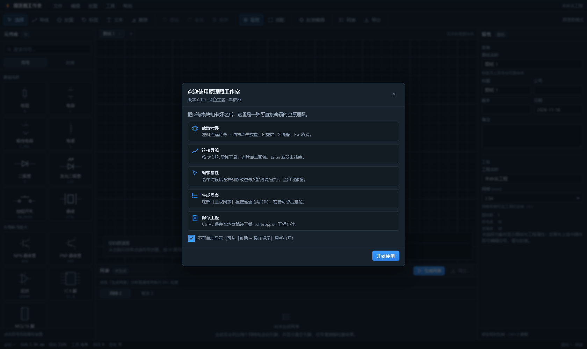

# 原理图工作室 · 使用教程

本文按真实界面操作顺序编写，覆盖「放置元件 → 连线 → 改位号与值 → 分配封装 → 绘制封装 → 生成网表 → 导出」全流程。
界面截图来自实际运行（深色主题），图中标注的按钮与菜单名称可直接在界面上找到。

## 1. 启动与界面总览

在仓库根目录运行：

```bash
node server.mjs
```

浏览器打开 <http://localhost:8080>，首次启动会弹出「欢迎使用原理图工作室」对话框，列出放置元件、连接导线、编辑属性、生成网表、保存工程五步提示。
勾选「不再自动显示」后可从「帮助 → 操作提示」重新打开；点击「开始使用」进入编辑界面。



界面分为六块：

| 区域 | 内容 |
| --- | --- |
| 顶部菜单栏 | 文件、编辑、放置、工具、帮助 |
| 工具栏 | 选择、导线、放置、标签、文本、删除；撤销、重做、删除；吸附、适配；封装编辑；网表、导出 |
| 左侧「元件库」面板 | 搜索框、符号/封装切换、分类列表（基础元件、半导体与放大、电源与地、连接器与模块）、缩略图 |
| 中间画布 | 图纸标签页（图纸 1、＋）、原理图/封装画布 |
| 右侧「属性」面板 | 属性 / 图纸 两个标签页，选中对象时显示对应属性 |
| 底部「网表」面板 | 生成网表、导出…、网络/警告列表与统计 |
| 底部状态栏 | 坐标、网格、缩放、工具、网络、吸附，以及当前图纸与选择状态 |

## 2. 打开示例工程（最快跑通）

菜单「文件 → 打开示例：LED 指示灯」会直接载入内置示例（静态打包，不需要网络请求）：

- 4 个符号：VCC（#PWR01）、R1（220R）、D1（LED）、GND（#PWR02）
- 3 段导线：VCC → R1、R1 → LED 阳极、LED 阴极 → GND
- 3 个网络：VCC、N$1、GND；6 个引脚、4 个元件、0 条检查警告

「文件 → 打开示例：MCU 最小系统」载入更完整的示例：MCU_16（U1）、两个 100nF 去耦电容（C1、C2）、8MHz 晶振（Y1）、两个测试点（TP1、TP2），使用 +5V 与 GND 电源符号、全局标签 XTAL_IN / XTAL_OUT、3 个结点，并自带测试点符号与 HC-49S 晶振封装（演示工程内自定义库）。该示例故意保留若干未连接引脚，用于演示 ERC 的悬空引脚告警。

## 3. 原理图绘制


上图是载入 LED 示例后的编辑界面：画布中自上而下是 VCC、R1（220R）、D1（LED）、GND，三段导线把电源经限流电阻接到 LED 再回到 GND；左侧元件库显示 18 个内置符号缩略图；右侧「图纸」标签页显示图纸名称、标题、公司、版本、日期与工程名称/网格/图纸数/符号库/封装库；底部网表尚未生成；底部状态栏显示坐标、网格 2.54 mm、缩放、工具、网络数、吸附状态。图中同时展开了「文件」菜单（新建工程、打开工程…、保存、另存为…、导出网表…、导出 SVG…、导出 PNG…、导出封装库 JSON…、恢复本地草稿；本次新增的「打开示例」入口也位于这个菜单中）。

### 3.1 放置元件

1. 在左侧「元件库」面板的搜索框输入关键字（如 `R`、`LED`），或用分类筛选。
2. 点击符号缩略图，进入放置模式。
3. 在画布上点击放置；放置前按 `R` 旋转 90°、按 `X` 水平镜像、按 `Esc` 取消。
4. 连续点击可连续放置同一符号；按住 `Shift` 点击结束连续放置。

### 3.2 连接导线

1. 点击工具栏「导线」或按 `W` 进入导线工具。
2. 在起点单击，移动鼠标会实时预览；再次单击落下一段。
3. 鼠标靠近引脚端点、导线端点或折点时会自动吸附；在已有导线上落点会自动处理结点（T 形连接会生成结点）。
4. 按 `Enter` 或双击结束当前折线；按 `Esc` 取消整条导线，按 `Backspace` 回退上一段。
5. 画布平移：空格 + 拖动或中键拖动；缩放：滚轮（以光标为中心）。

### 3.3 选择、移动与删除

- 点击工具栏「选择」或按 `V` 进入选择工具；单击选中对象，`Shift` + 单击多选，在空白处拖动框选。
- 拖动选中对象可移动，移动时会吸附到栅格与端点；`R` 旋转所选符号、`X` 镜像所选符号。
- 按 `Delete` 或点击工具栏「删除」删除所选；`Ctrl+Z` 撤销、`Ctrl+Shift+Z`（或 `Ctrl+Y`）重做。

## 4. 修改位号、值与封装

1. 用选择工具点中符号，右侧「属性」面板出现「元件属性」。
2. 修改「位号」（如 R1 → R2）、「值」（如 220R → 1k）；输入框修改即时生效，可用 `Ctrl+Z` 撤销。
3. 「封装」下拉框从工程库选择封装（如 R_0805、C_0603、DIP-8、QFP-32），选择「（无封装）」表示不分配。
4. 「X (mm)」「Y (mm)」「旋转」「镜像（水平镜像）」可精确调整放置。
5. 「符号信息」区显示符号 ID、符号名称、引脚数、位号前缀与描述；下方按钮提供「旋转 90°」「镜像」「删除」。
6. 未选中对象时，右侧面板显示「图纸」内容：图纸名称、标题、公司、版本、日期、备注，以及工程名称、网格 (mm)、图纸数、符号库、封装库。
7. 多张图纸：画布上方标签页切换；双击标签页重命名；点「＋」新建；标签页右侧的删除按钮会先确认。

## 5. 绘制封装

1. 点击工具栏「封装编辑」（或菜单「放置 → 封装编辑 / 返回原理图」）进入封装模式。
2. 模式栏提供「选择 / 焊盘 / 移动 / 图形」四个工具与「撤销 / 重做 / 删除 / 适配」。
3. 焊盘工具：点击放置焊盘，焊盘编号自动递增；右侧「焊盘属性」可设置编号、形状（矩形 / 圆角矩形 / 圆形 / 椭圆）、X (mm) / Y (mm)、宽 (mm) / 高 (mm)、层（顶层 (SMD) / 底层 (SMD) / 通孔 (THT)）、旋转 (°) 与钻孔 (mm)。
4. 图形工具：在丝印、Courtyard、Assembly、Fab 图层绘制「直线 / 折线」或「矩形」；左侧「封装图层」面板可切换图形图层、图形形状与焊盘层。
5. 封装模式使用固定 0.635 mm 栅格，吸附开关只作用于原理图。
6. 完成后点击「保存到工程库」写入当前工程；点击「返回原理图」退出，若有未保存修改会先确认。
7. 左侧元件库面板「封装」页可查看工程库封装并「新建封装」；「文件 → 导出封装库 JSON…」可把工程库封装导出为 JSON。

## 6. 生成网表与 ERC


上图是点击「生成网表」后的状态：底部「网表」面板显示四个计数「网络 3 / 引脚 6 / 元件 4 / 警告 0」，网络列表展开后可看到 GND（#PWR02.1、D1.2）与 N$1（R1.2、D1.1）等网络及其引脚；底部状态栏的「网络」一项同步显示 3；画布仍是 VCC → R1 220R → D1 LED → GND 的电路。

1. 点击底部「生成网表」（或菜单「工具 → 生成网表」）执行连通性分析与 ERC。
2. 顶部徽标由「未生成」变为「已生成」；统计行显示网络、引脚、元件、警告四个计数。
3. 「网络」标签列出每个网络的名称与引脚（如 `GND` 下的 `#PWR02.1`、`D1.2`），点击引脚可定位并选中对应元件。
4. 「警告」标签列出问题（悬空引脚、单脚网络、位号重复、缺少封装、未连接导线、电源输出冲突等），点击警告可跳转定位。
5. 工程被修改后统计行提示「工程已修改，结果可能过期」，重新生成即可刷新。

> **电源网络命名规则**：电源网络名取自电源符号的引脚名——`VCC` 符号产生 `VCC` 网络，`+5V` 符号产生 `+5V` 网络，`GND` 符号产生 `GND` 网络；网络名不随电压数值自动映射。其余网络的命名优先级为：电源名 > 全局标签 > 局部标签 > 自动 `N$n`。

## 7. 导出

### 7.1 网表导出

菜单「文件 → 导出网表…」或按 `Ctrl+E`（也可点网表面板的「导出…」）打开「导出网表」对话框：

- 顶部选择格式：**JSON 网表**（.net.json）、**CSV 网表**（.net.csv）、**KiCad 6 网表**（.net）、**Protel / PCBNEW 网表**（.net）。
- 统计行显示当前工程的「网络 / 引脚 / 元件 / 警告」；预览区实时生成内容。
- 「复制」写入剪贴板，「下载文件」保存到本地，文件名格式为「工程名-图纸名.net.*」。

四种格式说明：

| 格式 | 结构 | 适用场景 |
| --- | --- | --- |
| JSON | `format/version/generator/project/components/nets/warnings/stats`，缩进 2 | 脚本处理、自动化校验 |
| CSV | 表头 `designator,pin,name,net`，每个引脚一行，含逗号/引号时自动转义，未连接引脚 net 为空 | 表格查看、导入 Excel |
| KiCad 6 | S-表达式 `(export (version "E") (design) (components) (nets))`，含 pinfunction/pintype | 导入 KiCad 6+ |
| Protel / PCBNEW | 文本网表，含 `[Design]`、`[Components]`、`[NETLIST]` 段 | 导入 Protel/Altium 系工具 |

### 7.2 图形与其他导出

- **SVG**：菜单「文件 → 导出 SVG…」，矢量导出当前图纸（含标题栏），可在浏览器或设计软件中打开。
- **PNG**：菜单「文件 → 导出 PNG…」，按 2 倍分辨率导出当前画布。
- **封装库 JSON**：菜单「文件 → 导出封装库 JSON…」，导出工程库中的封装定义。

## 8. 保存、打开与恢复

- **保存**：`Ctrl+S`（或「文件 → 保存」）把工程写入浏览器本地草稿并下载 `.schproj.json` 文件。
- **另存为**：`Ctrl+Shift+S` 输入新的工程名后保存。
- **打开工程**：`Ctrl+O` 或「文件 → 打开工程…」选择本地 `.schproj.json`；解析失败时会列出具体校验错误。
- **恢复本地草稿**：「文件 → 恢复本地草稿」，读取浏览器中上次保存的内容。
- **新建工程**：`Ctrl+N` 新建空白工程（未保存修改会先确认）。

## 9. 快捷键

界面级快捷键（输入框聚焦时不拦截编辑类快捷键）：

| 快捷键 | 功能 |
| --- | --- |
| `Ctrl+N` | 新建工程 |
| `Ctrl+S` | 保存工程（本地草稿 + 下载 JSON） |
| `Ctrl+Shift+S` | 另存为 |
| `Ctrl+O` | 打开工程 |
| `Ctrl+E` | 导出网表 |
| `W` | 导线工具 |
| `V` | 选择工具 |
| `G` | 切换网格吸附（标签工具中切换全局/局部） |
| `R` | 旋转所选符号 90°（放置时旋转预览） |
| `X` | 镜像所选符号（放置时切换镜像） |
| `+` / `-` | 放大 / 缩小 |
| `F` | 缩放适配内容 |
| `?` | 快捷键与帮助 |

编辑器与工具快捷键：

| 快捷键 | 功能 |
| --- | --- |
| `Ctrl+Z` / `Ctrl+Shift+Z`、`Ctrl+Y` | 撤销 / 重做 |
| `Ctrl+A` | 全选当前图纸 |
| `Delete` | 删除所选 |
| `Esc` | 取消当前操作 / 取消选择 |
| `Enter` / 双击 | 结束连续画线 |
| `Shift` + 点击 | 结束连续放置 |
| 空格 + 拖动 / 中键拖动 | 平移画布 |
| 滚轮 | 以光标为中心缩放 |
| `L` / `R` / `H` / `1-4` | 封装工具：切图层 / 切形状 / 通孔 / 焊盘形状 |

## 10. 示例工程

| 文件 | 内容 | 网表统计 |
| --- | --- | --- |
| `examples/demo-led.json` | VCC、R1 220R、D1 LED、GND；3 段导线；网络 VCC / N$1 / GND | 网络 3 · 引脚 6 · 元件 4 · 警告 0 |
| `examples/demo-mcu.json` | MCU_16（U1）、C1/C2 100nF、Y1 8MHz、TP1/TP2 测试点；+5V/GND 电源、XTAL_IN/XTAL_OUT 全局标签、3 个结点、自定义 TP 符号与 HC-49S 封装 | 网络 16 · 引脚 26 · 元件 8 · 警告 10（未用引脚悬空，用于演示 ERC） |

两个示例都能通过 `deserializeProject` 的严格校验，可直接用「文件 → 打开示例」载入，也可用 `fetch('examples/demo-led.json')` 做自动化测试。

## 11. FAQ

**Q：为什么示例里是 `VCC` 网络而不是 `+5V`？**
A：网络名来自电源符号的引脚名。`VCC` 符号的引脚名是 `VCC`，`+5V` 符号的引脚名才是 `+5V`。工程里要使用 `+5V` 网络，请从「元件库 → 电源与地」放置 `+5V` 符号（`examples/demo-mcu.json` 即如此）。

**Q：生成网表后出现「悬空引脚」警告，需要处理吗？**
A：未使用的引脚会出现 `FLOATING_PIN`；如果是有意保留，可忽略或后续接测试点/上拉电阻。示例 `demo-mcu` 故意保留这些引脚来演示 ERC。

**Q：为什么保存后还要下载文件？**
A：`Ctrl+S` 同时写浏览器本地草稿（用于「恢复本地草稿」）并下载 `.schproj.json` 作为可迁移的工程文件；浏览器清理站点数据后本地草稿会丢失。

**Q：打开工程提示校验失败怎么办？**
A：对话框会列出缺失或类型错误的字段路径（如 `sheets[0].symbols[0].designator`），可对照 `docs/CONTRACTS.md` 的数据结构修补，或从示例工程重新开始。

**Q：封装编辑时为什么吸附关闭了？**
A：封装模式固定使用 0.635 mm 栅格，工具栏的吸附开关只对原理图生效，模式栏会给出提示。

**Q：示例工程菜单打不开 / 页面空白？**
A：示例数据通过原生 JSON 模块静态导入，需要较新的 Chrome / Edge（支持 import attributes，约 123+）。旧浏览器会无法加载入口模块，请升级浏览器。

**Q：导出文件在哪里？**
A：SVG / PNG / 网表 / 工程 JSON 均通过浏览器下载保存，位置取决于浏览器的下载目录设置。
