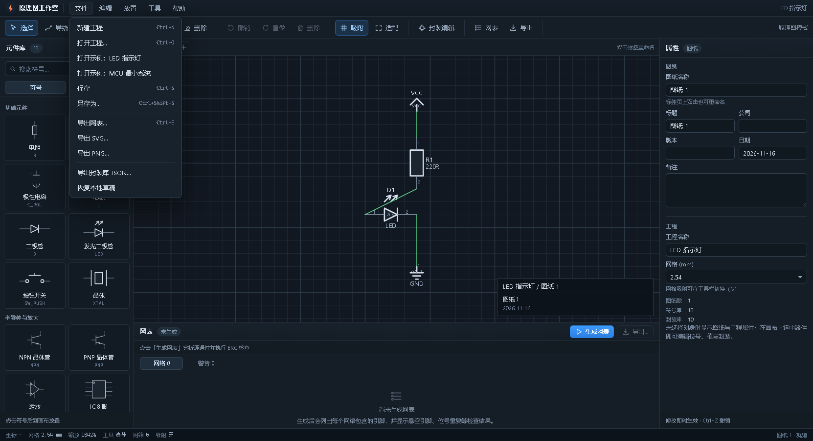
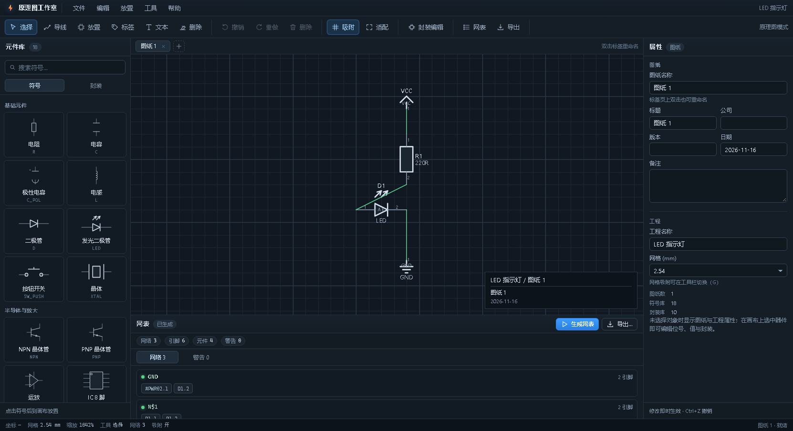

# 原理图工作室 · 使用教程

本文按真实界面操作顺序编写，覆盖「放置元件 → 连线 → 改位号与值 → 分配封装 → 绘制封装 → 生成网表 → 导出 → 导入 KiCad 网表」全流程。
界面截图来自实际运行（深色主题），图中标注的按钮与菜单名称可直接在界面上找到。

## 1. 启动与界面总览

在仓库根目录运行：

```bash
node server.mjs
```

浏览器打开 <http://127.0.0.1:8080>（服务器默认只监听本机；需要局域网访问时用 `HOST=0.0.0.0 node server.mjs`）。建议使用 Chrome / Edge 123+；示例数据依赖 JSON 模块动态导入，旧浏览器仍可启动编辑器，仅在打开示例时提示升级。
首次启动会弹出「欢迎使用原理图工作室」对话框，列出放置元件、连接导线、编辑属性、生成网表、保存工程五步提示。
勾选「不再自动显示」后可从「帮助 → 操作提示」重新打开；点击「开始使用」进入编辑界面。


界面分为六块：

| 区域 | 内容 |
| --- | --- |
| 顶部菜单栏 | 文件、编辑、放置、工具、帮助 |
| 工具栏 | 选择、导线、放置、标签、文本、删除；撤销、重做、删除；吸附、适配；封装编辑；网表、导出 |
| 左侧「元件库」面板 | 搜索框、符号/封装切换、分类列表（基础元件、半导体与放大、电源与地、连接器与模块）、缩略图 |
| 中间画布 | 图纸标签页（图纸 1、＋）、原理图/封装画布 |
| 右侧「属性」面板 | 属性 / 图纸 两个标签页，选中对象时显示对应属性 |
| 底部「网表」面板 | 生成网表、导出…、网络/警告列表与统计 |
| 底部状态栏 | 坐标、网格、缩放、工具、网络、吸附，以及当前图纸与选择状态 |

## 2. 打开示例工程（最快跑通）

菜单「文件 → 打开示例：LED 指示灯」会直接载入内置示例（静态打包，不需要网络请求）：

- 4 个符号：VCC（#PWR01）、R1（220R）、D1（LED）、GND（#PWR02）
- 3 段导线：VCC → R1、R1 → LED 阳极、LED 阴极 → GND
- 3 个网络：VCC、N$1、GND；6 个引脚、4 个元件、0 条检查警告

「文件 → 打开示例：MCU 最小系统」载入更完整的示例：MCU_16（U1）、两个 100nF 去耦电容（C1、C2）、8MHz 晶振（Y1）、两个测试点（TP1、TP2），使用 +5V 与 GND 电源符号、全局标签 XTAL_IN / XTAL_OUT、3 个结点，并自带测试点符号与 HC-49S 晶振封装（演示工程内自定义库）。该示例故意保留若干未连接引脚，用于演示 ERC 的悬空引脚告警。

## 3. 原理图绘制



上图是载入 LED 示例后的编辑界面：画布中自上而下是 VCC、R1（220R）、D1（LED）、GND，三段导线把电源经限流电阻接到 LED 再回到 GND；左侧元件库显示 18 个内置符号缩略图；右侧「图纸」标签页显示图纸名称、标题、公司、版本、日期与工程名称/网格/图纸数/符号库/封装库；底部网表尚未生成；底部状态栏显示坐标、网格 2.54 mm、缩放、工具、网络数、吸附状态。图中同时展开了「文件」菜单（新建工程、打开工程…、打开示例：LED 指示灯 / MCU 最小系统、保存、另存为…、导出网表…、导出 SVG…、导出 PNG…、导出封装库 JSON…、恢复本地草稿）。

> 该截图拍摄于网表导入功能上线之前：当前「文件」菜单在「打开工程…」与「打开示例…」之间还多一项「导入 KiCad 网表…」，用法见第 8 章。

### 3.1 放置元件

1. 在左侧「元件库」面板的搜索框输入关键字（如 `R`、`LED`），或用分类筛选。
2. 点击符号缩略图，进入放置模式。
3. 在画布上点击放置；放置前按 `R` 旋转 90°、按 `X` 水平镜像、按 `Esc` 取消。
4. 连续点击可连续放置同一符号；按住 `Shift` 点击结束连续放置。

### 3.2 连接导线

1. 点击工具栏「导线」或按 `W` 进入导线工具。
2. 在起点单击，移动鼠标会实时预览；再次单击落下一段。
3. 鼠标靠近引脚端点、导线端点或折点时会自动吸附；在已有导线上落点会自动处理结点（T 形连接会生成结点）。
4. 按 `Enter` 或双击结束当前折线；按 `Esc` 取消整条导线，按 `Backspace` 回退上一段。
5. 画布平移：空格 + 拖动或中键拖动；缩放：滚轮（以光标为中心）。

### 3.3 选择、移动与删除

- 点击工具栏「选择」或按 `V` 进入选择工具；单击选中对象，`Shift` + 单击多选，在空白处拖动框选。
- 拖动选中对象可移动，移动时会吸附到栅格与端点；`R` 旋转所选符号、`X` 镜像所选符号。
- 按 `Delete` 或点击工具栏「删除」删除所选；`Ctrl+Z` 撤销、`Ctrl+Shift+Z`（或 `Ctrl+Y`）重做。

## 4. 修改位号、值与封装

1. 用选择工具点中符号，右侧「属性」面板出现「元件属性」。
2. 修改「位号」（如 R1 → R2）、「值」（如 220R → 1k）；输入框修改即时生效，可用 `Ctrl+Z` 撤销。
3. 「封装」下拉框从工程库选择封装（如 R_0805、C_0603、DIP-8、QFP-32），选择「（无封装）」表示不分配。
4. 「X (mm)」「Y (mm)」「旋转」「镜像（水平镜像）」可精确调整放置。
5. 「符号信息」区显示符号 ID、符号名称、引脚数、位号前缀与描述；下方按钮提供「旋转 90°」「镜像」「删除」。
6. 未选中对象时，右侧面板显示「图纸」内容：图纸名称、标题、公司、版本、日期、备注，以及工程名称、网格 (mm)、图纸数、符号库、封装库。
7. 多张图纸：画布上方标签页切换；双击标签页重命名；点「＋」新建；标签页右侧的删除按钮会先确认。

## 5. 绘制封装

1. 点击工具栏「封装编辑」（或菜单「放置 → 封装编辑 / 返回原理图」）进入封装模式。
2. 模式栏提供「选择 / 焊盘 / 移动 / 图形」四个工具与「撤销 / 重做 / 删除 / 适配」。
3. 焊盘工具：点击放置焊盘，焊盘编号自动递增；右侧「焊盘属性」可设置编号、形状（矩形 / 圆角矩形 / 圆形 / 椭圆）、X (mm) / Y (mm)、宽 (mm) / 高 (mm)、层（顶层 (SMD) / 底层 (SMD) / 通孔 (THT)）、旋转 (°) 与钻孔 (mm)。
4. 图形工具：在丝印、Courtyard、Assembly、Fab 图层绘制「直线 / 折线」或「矩形」；左侧「封装图层」面板可切换图形图层、图形形状与焊盘层。
5. 封装模式使用固定 0.635 mm 栅格，吸附开关只作用于原理图。
6. 完成后点击「保存到工程库」写入当前工程；点击「返回原理图」退出，若有未保存修改会先确认。
7. 左侧元件库面板「封装」页可查看工程库封装并「新建封装」；「文件 → 导出封装库 JSON…」可把工程库封装导出为 JSON。

## 6. 生成网表与 ERC



上图是点击「生成网表」后的状态：底部「网表」面板显示四个计数「网络 3 / 引脚 6 / 元件 4 / 警告 0」，网络列表展开后可看到 GND（#PWR02.1、D1.2）与 N$1（R1.2、D1.1）等网络及其引脚；底部状态栏的「网络」一项同步显示 3；画布仍是 VCC → R1 220R → D1 LED → GND 的电路。

1. 点击底部「生成网表」（或菜单「工具 → 生成网表」）执行连通性分析与 ERC。
2. 顶部徽标由「未生成」变为「已生成」；统计行显示网络、引脚、元件、警告四个计数。
3. 「网络」标签列出每个网络的名称与引脚（如 `GND` 下的 `#PWR02.1`、`D1.2`），点击引脚可定位并选中对应元件；每个网络行右侧还有 net class 徽标（`Default` 或导入工程的 `pwr`、`clk` 等，见 7.1.2）。
4. 「警告」标签列出问题（悬空引脚、单脚网络、位号重复、缺少封装、未连接导线、电源输出冲突等），点击警告可跳转定位。
5. 工程被修改后统计行提示「工程已修改，结果可能过期」，重新生成即可刷新。

> **电源网络命名规则**：电源网络名取自电源符号的引脚名——`VCC` 符号产生 `VCC` 网络，`+5V` 符号产生 `+5V` 网络，`GND` 符号产生 `GND` 网络；网络名不随电压数值自动映射。其余网络的命名优先级为：电源名 > 全局标签 > 局部标签 > 自动 `N$n`。

## 7. 导出

### 7.1 网表导出

菜单「文件 → 导出网表…」或按 `Ctrl+E`（也可点网表面板的「导出…」）打开「导出网表」对话框：

- 顶部选择格式：**JSON 网表**（.net.json）、**CSV 网表**（.net.csv）、**KiCad 9 网表**（.net，version E）、**Protel / PCBNEW 网表**（.net）。
- 统计行显示当前工程的「网络 / 引脚 / 元件 / 警告」；预览区实时生成内容。
- 选中 KiCad 9 时格式卡片显示「KiCad 9 (version E)」，下方提示「S-表达式网表，UTF-8 无 BOM、CRLF 行尾」。
- 「复制」写入剪贴板，「下载文件」保存到本地，文件名格式为「工程名-图纸名.<扩展名>」（如 LED 示例导出 JSON 为 `LED 指示灯-图纸 1.net.json`，导出 KiCad 为 `LED 指示灯-图纸 1.net`）。

四种格式说明：

| 格式 | 结构 | 适用场景 |
| --- | --- | --- |
| JSON | `format/version/generator/project/components/nets/warnings/stats`，缩进 2 | 脚本处理、自动化校验 |
| CSV | 表头 `designator,pin,name,net`，每个引脚一行，含逗号/引号时自动转义，未连接引脚 net 为空 | 表格查看、导入 Excel |
| KiCad 9 | S-表达式 `(export (version "E") (design …) (components …) (libparts …) (libraries …) (nets …))`，含 sheet/title_block/comment、libsource、property、sheetpath、pinfunction、pintype 与 net class | 交给 KiCad 6+ / KiCad 9 与 PCB 工具，或再导入本编辑器（第 8 章） |
| Protel / PCBNEW | 文本网表，含 `[Design]`、`[Components]`、`[NETLIST]` 段 | 导入 Protel/Altium 系工具 |

#### 7.1.1 KiCad 9 网表的分节

`(export (version "E") …)` 下固定六个分节，顺序如下：

| 分节 | 内容 |
| --- | --- |
| `export` | 根节点，`version` 固定为 `"E"`（KiCad 9 的网表版本号就是 `E`） |
| `design` | `source`（源 `.kicad_sch` 绝对路径）、`date`（带时区的时间戳）、`tool`；每张图纸一个 `sheet`：`number` / `name`（KiCad 图纸路径，如 `/`、`/RP2040/`）/ `tstamps`，以及 `title_block`（`title`、`company`、`rev`、`date`、`source` 与 `comment 1…9`，9 个槽位固定输出，空槽写作 `(comment (number "4") (value ""))`） |
| `components` | 每个元件一个 `comp`：`ref`、`value`、`footprint`、`datasheet`、`fields`（Reference / Value / Footprint / Datasheet / Description 五个标准字段）、`libsource`（`lib` + `part`）、`property`（`Sheetname`、`Sheetfile` 等工程属性）、`sheetpath`（`names` + `tstamps`）与 `tstamps` |
| `libparts` | 每个用到的库符号一个 `libpart`：`lib`、`part`、`description`、`docs`、`footprints`、`fields` 与 `pins`（`pin` 的 `num`、`name`、`type`）；没有引脚的符号（如基准点 `Fiducial`）不输出 `pins` 块 |
| `libraries` | 每个库一个 `library`：`logical`（库名）与 `uri`（库文件路径） |
| `nets` | 每个网络一个 `net`：`code`（从 1 连续编号）、`name`、`class`，下面是若干 `node`：`ref` + `pin`，可选 `pinfunction`（引脚名原文，为空时整段省略），以及 `pintype`（`passive`、`input`、`bidirectional` 等基础类型，可带 `+no_connect` / `+free` 修饰，如 `bidirectional+no_connect`、裸 `no_connect`） |

未连接引脚按 KiCad 9 规则合成网络：单个引脚、未进入任何保留网络的自动网络 `N$n` 不写成网络，而写成 `unconnected-(<位号>-<引脚名>-Pad<引脚号>)`，例如 `unconnected-(U3-NC-Pad4)`、`unconnected-(X1-Tri-State-Pad1)`；电源符号只有单脚时不参与该合成（保留其电源网络）。

文件级格式与 KiCad 9 写出的文本一致，可直接替换原文件：UTF-8 无 BOM、CRLF 行尾、**文件末尾没有换行**、每层缩进 2 空格、结构性子元素各占一行、闭括号并回最后一行。

完整的语法定义、取值词汇、转义规则与数据契约见 **[NETLIST_KICAD_SPEC.md](NETLIST_KICAD_SPEC.md)**（由 `examples/tinytapeout-demo.net` 实测归纳）。

排序规则（与 KiCad 9 输出对齐）：

- `components`：先按图纸顺序，再按图纸内位号的自然序。`examples/tinytapeout-demo.net` 里 `C4`（索引 3）在 `C10`（索引 9）之前，而 `C29` 属于 `/RP2040/` 图纸、`C42` 属于根图纸，所以 `C42`（索引 28）排在 `C29`（索引 125）之前。
- `nets`：按网络名自然序；同名再按 ASCII 比较。
- 每个 `net` 内的 `node`：按 `ref`、再按 `pin` 的纯 ASCII 字节序（引脚 `"12"` 排在 `"6"` 之前）。
- `libparts`：按 `part` 自然序，同 `part` 再比 `lib`。

#### 7.1.2 net class 的来源与缺省值

`net@class` 是 KiCad 的「网络类」，用于给差分对、电源、时钟等网络分组布线约束。导出时按以下顺序取类名（正常路径下第 1 步已由连通性分析填好，后两步是兜底）：

1. 网络对象上的 class（连通性分析的结果，如 `net.class`）；
2. 工程的网络类映射 `project.netClassAssignments`（网络名 → 类名，连通性分析据此填充 `net.class`；导入 KiCad 网表时自动写入，新建工程默认为空）；
3. 都没有时写 `Default` —— 所有网络都会输出 `class`，缺省值也是 `Default`，不会省略该字段。

也就是说：新建或手绘的工程导出 KiCad 网表时网络全部是 `Default`；导入 `examples/tinytapeout-demo.net` 后，114 个网络里有 69 个 `Default`，其余 45 个分布到 `pwr`(3)、`pwrhi`(2)、`config`(7)、`clk`(3)、`ioout`(12)、`ioin`(8)、`iobidir`(8)、`usbdiff`(2)，共 9 类。网表面板会给每个网络行显示 class 徽标（鼠标悬停提示「net class：<类名>」）。

### 7.2 图形与其他导出

- **SVG**：菜单「文件 → 导出 SVG…」，矢量导出当前图纸（含标题栏），可在浏览器或设计软件中打开。
- **PNG**：菜单「文件 → 导出 PNG…」，按 2 倍分辨率导出当前画布。
- **封装库 JSON**：菜单「文件 → 导出封装库 JSON…」，导出工程库中的封装定义。

## 8. 导入 KiCad 网表

编辑器可以把 KiCad 导出的 `.net`（S-表达式，`(export (version "E") …)`）反向重建为可编辑工程：还原元件、库符号、多图纸归属、网络类与「哪个引脚连到哪个网络」的连通关系。这一章用仓库自带的 `examples/tinytapeout-demo.net`（KiCad 9.0.8 实际导出的 150 元件 / 114 网络样本）走一遍完整流程。

### 8.1 操作步骤

1. 「文件 → 导入 KiCad 网表…」打开独立的文件选择器（`accept=".net,text/plain"`，不影响「打开工程…」的 `.schproj.json` 过滤器）。
2. 选择 `.net` 文件后立即解析：
   - 解析失败只会弹出「无法导入 KiCad 网表」对话框，逐条列出错误（含行号与错误码，如 `第 1 行 [MISSING_EXPORT] 网表必须以 (export …) 列表开头`），当前工程与选区不会被改动；
   - 解析成功但当前工程有未保存修改时，弹出确认框「当前工程有未保存的修改，导入网表将丢弃这些修改。」，确认按钮为「导入网表」；
   - 若当时处于封装编辑模式，会先退出封装模式。
3. 导入完成后文件选择器关闭，画布自动适配内容，并弹出提示：`已导入 KiCad 网表：元件 150 · 网络 114 · 图纸 2`；如还有非致命提示，会再补一条「导入完成，另有 N 条提示」。
4. 导入不会自动生成网表：点底部「生成网表」（或菜单「工具 → 生成网表」）后才显示网络、class 与 ERC 结果。

> 导入得到的是普通工程：可以继续放置、连线、改位号/值/封装，也可以 `Ctrl+S` 保存为 `.schproj.json`。KiCad 侧的元数据（design 的 `source`/`tool`/`date`、库 URI、net class、标题栏与 9 槽备注、元件 `libsource`/`fields`/`property`/`sheetpath`/`tstamps`）一并保存在工程的 `kicad` 字段里，重新导出 KiCad 网表时沿用。

### 8.2 导入做了什么

| 步骤 | 行为 |
| --- | --- |
| 解析 | 通用 S-表达式词法/语法分析 → 投影为 `version` / `design`（`sheets` + 每图纸 `title_block`）/ `components` / `libparts` / `libraries` / `nets` 六个投影；报错带行号与错误码 |
| 库符号 | 每个 `libpart` 生成一个工程库符号：矩形本体、按 `pins` 顺序排在左侧的引脚（引脚名/号/电气类型）、`Reference` 前缀取自 `fields`（缺失时按位号推断），`docs`、`footprints`、`ki_keywords`、`ki_fp_filters` 一并保留 |
| 多图纸 | 按 `design.sheets` 的顺序建图纸（`number` 排序）；`comp.sheetpath` 决定元件归属；图纸显示名取 KiCad 图纸路径的最后一段（`/` → `Root`，`/RP2040/` → `RP2040`），完整的 KiCad 路径仍保存在 `sheet.kicad.name` |
| 摆放 | 网表不含坐标，按 2.54 mm 网格行优先排列：符号本体宽 12.7 mm、引脚 2.54 mm、引脚引出导线 2.54 mm，每行最宽 420 mm，超出换行；行高取该行最高符号，保证符号/引脚/标签不重叠 |
| 连通性 | 每个引脚引出一段 2.54 mm 的 stub 导线，导线末端放一个同名网络标签；同名标签在连通性分析中合网，因此重新「生成网表」能推导出与源网表一致的引脚集合。`no_connect` 引脚不引 stub（保持未连接） |
| 网络名 | 先做 `{slash}` → `/` 解码；跨图纸网络一律用全局标签 + 完整解码名，单图纸且带图纸路径前缀的局部网络用局部标签并去掉前缀 |
| 网络类 | `net@class` 写入 `project.netClassAssignments`（网络名 → 类名）；`unconnected-(…)` 网络跳过，不建标签也不写映射 |
| 校验 | 导入结果会过一遍工程校验；非法时返回 `PROJECT_INVALID` 诊断而不是半成品工程 |

### 8.3 完整走查：导入 tinytapeout-demo.net 并对比导出结果

准备：仓库根目录启动 `node server.mjs`，浏览器打开 <http://127.0.0.1:8080>。

**第 1 步 · 导入。** 「文件 → 导入 KiCad 网表…」→ 选择 `examples/tinytapeout-demo.net`。预期看到：

- 提示：`已导入 KiCad 网表：元件 150 · 网络 114 · 图纸 2`；
- 图纸标签页变为两个：`Root` 与 `RP2040`（元件数分别是 125 与 25）；
- 画布上是网格阵列的统一矩形符号（左侧一排引脚 + 每脚一段短导线 + 末端标签），不是 KiCad 里的原始版图；
- 工程名变为 `tinytapeout-demo`（取自 `design.source` 的文件名）。

**第 2 步 · 生成网表看网络与 class。** 点「生成网表」。预期统计行为：`网络 113 / 引脚 583 / 元件 150 / 警告 5`。

- 网络列表每行右侧显示 class 徽标（悬停提示「net class：<类名>」），共 9 类：`Default`、`pwr`、`pwrhi`、`config`、`clk`、`ioin`、`ioout`、`iobidir`、`usbdiff`；
- 113 = 源网表的 108 个标注网络 + 5 个悬空引脚的单引脚自动网络（`N$1`…`N$5`）；源文件的 6 个 `unconnected-(…)` 网络按设计不重建标签，因此不出现；
- 5 条警告都是 `SINGLE_PIN_NET`（`N$1`…`N$5`，对应 J15-A8、J15-B8、J16-1、J18-1、X1-1 这些在源网表里本就是 unconnected 的引脚），可以忽略；U3 的第 4 脚带 `no_connect` 标记，不产生导线也不产生警告。

**第 3 步 · 再导出 KiCad 网表。** `Ctrl+E` → 选「KiCad 9 网表」→「下载文件」（文件名形如 `tinytapeout-demo-Root.net`）。预览区首行应是 `(export (version "E")`，格式卡片提示「KiCad 9 (version E)」。

**第 4 步 · 对比「网络名 + 引脚集合」。** 在仓库根目录运行下面这段脚本（导入 → 再导出 → 分别解析两份文本）：

```bash
node --input-type=module -e "
import { readFileSync } from 'node:fs';
import { importKiCadNetlist } from './src/netlist/kicad-import.js';
import { readKiCadNetlist } from './src/netlist/kicad-reader.js';
import { generateKiCad } from './src/netlist/index.js';
const text = readFileSync('examples/tinytapeout-demo.net', 'utf8');
const { project } = importKiCadNetlist(text);
const before = readKiCadNetlist(text);
const after = readKiCadNetlist(generateKiCad(project));
const key = (doc) => doc.nets.map((n) => n.name + '=' + n.nodes.map((x) => x.ref + '.' + x.pin).sort().join(',')).sort();
console.log('网络数', before.nets.length, after.nets.length, '网络名+引脚集合一致:', JSON.stringify(key(before)) === JSON.stringify(key(after)));
"
```

实测输出：

```text
网络数 114 114 网络名+引脚集合一致: true
```

这一趟的完整实测数字（`node --input-type=module` 直接调 `importKiCadNetlist` / `generateKiCad` 得到）：

| 指标 | 源 `.net` | 再导出 |
| --- | --- | --- |
| 元件 | 150 | 150 |
| 网络 | 114 | 114（网络名集合完全相同） |
| 引脚节点 | 584 | 584（逐网络「排序后 ref.pin 集合」0 差异） |
| net class | `Default` 69 + 非 `Default` 45 | 逐网络一致（9 类直方图相同） |
| libparts | 28 | 28 |
| 图纸 / 标题栏 | 2 图纸、每图纸 9 槽 comment | 一致 |
| 文件字节 | 254285 | 254285（**逐字节相同**，SHA-256 `2f92e581…a53f`，0 行差异） |
| 编码格式 | UTF-8 无 BOM、4679 处 CRLF、0 处裸 LF、末尾无换行 | 相同 |

再导出的文本与 KiCad 原文件**逐字节相同**：254285 字节、SHA-256 均为 `2f92e581a7b7451307f6536d9858e42351d2378cdc22b3dfb9ab19e4e831a53f`、0 行差异。这一比对由 `test/integration/kicad-roundtrip.test.mjs` 在每次 `npm test` 自动重跑，不是一次性人工核对。

> 这个字节级还原依赖「多值 `comp tstamps` 全量写回」：黄金样本里 `J4` 写了 3 个 UUID（第 1188 行）、`U4` 写了 5 个 UUID（第 2766 行）。早期快照每个元件只保留首个 `tstamps`，导出的文件会是 254051 字节、恰好这两行不同；网络名与引脚集合语义不受影响。若在旧快照上对比，请以「网络名 + 引脚集合一致」为准。

**第 5 步（可选）· 二次往返为不动点。** 把上面脚本改成对 `generateKiCad(project)` 的结果再执行一次 `importKiCadNetlist` → `generateKiCad`，两次输出逐字节相同（254283 字符 / 254285 字节），说明「再导出」的文本本身可以被再次无损读回。

### 8.4 提示、警告与失败

导入结果的 `warnings` 是**非致命**提示，UI 会以「导入完成，另有 N 条提示」提醒（不影响工程载入）：

| 警告码 | 含义 |
| --- | --- |
| `UNKNOWN_LIBPART` | 元件引用的 `lib:part` 不在 `libparts` 中，该元件没有引脚，不参与连通性 |
| `UNKNOWN_SHEETPATH` | `comp.sheetpath` 不在 `design.sheets` 中，元件归入根图纸 |
| `DUPLICATE_SHEET_PATH` / `DUPLICATE_LIBPART` / `DUPLICATE_COMP_REF` | 重复的图纸路径 / 库符号 / 位号，保留首个 |
| `PIN_TYPE_MISMATCH` / `PIN_MODIFIER_CONFLICT` | 同一符号引脚在不同实例上的电气类型或 `no_connect`/`free` 标记不一致 |
| `UNKNOWN_PIN_TYPE` | 引脚的电气类型不在 KiCad 12 种取值内，按 `passive` 处理 |
| `NET_CLASS_CONFLICT` / `EMPTY_NET_NAME` / `MISSING_PIN_POINT` | 同名网络对应多个 class / 解码后网络名为空 / 节点找不到引脚位置，相关节点跳过 |
| `SYMBOL_BUILD_FAILED` | 库符号构建失败，跳过该符号 |

致命错误（不会载入工程，`ok: false` 并在对话框列出）来自解析与结构校验：`MISSING_EXPORT`（不是 S-表达式网表 / 缺少 `export` 根）、`INVALID_TOKEN`、`UNTERMINATED_STRING`、`UNTERMINATED_LIST`、`DEPTH_EXCEEDED`、`TRAILING_TOKEN`、`MISSING_VERSION`、`MISSING_SECTION`、`MISSING_SHEET`、`MISSING_COMP_REF`、`MISSING_PIN_NUM`、`MISSING_PIN_TYPE`、`MISSING_NET_NAME`、`MISSING_LIBPART_KEY`、`MISSING_LIBRARY_LOGICAL`、`MISSING_NODE_KEY`、`MISSING_PROPERTY_NAME`，以及工程校验失败的 `PROJECT_INVALID`。例如把 `examples/demo-led.json` 当网表导入，会得到一条：`第 1 行 [MISSING_EXPORT] 网表必须以 (export …) 列表开头`。

## 9. 保存、打开与恢复

- **保存**：`Ctrl+S`（或「文件 → 保存」）把工程写入浏览器本地草稿并下载 `.schproj.json` 文件。
- **另存为**：`Ctrl+Shift+S` 输入新的工程名后保存。
- **打开工程**：`Ctrl+O` 或「文件 → 打开工程…」选择本地 `.schproj.json`；解析失败时会列出具体校验错误。
- **恢复本地草稿**：「文件 → 恢复本地草稿」，读取浏览器中上次保存的内容。
- **新建工程**：`Ctrl+N` 新建空白工程（未保存修改会先确认）。

## 10. 快捷键

界面级快捷键（输入框聚焦时不拦截编辑类快捷键）：

| 快捷键 | 功能 |
| --- | --- |
| `Ctrl+N` | 新建工程 |
| `Ctrl+S` | 保存工程（本地草稿 + 下载 JSON） |
| `Ctrl+Shift+S` | 另存为 |
| `Ctrl+O` | 打开工程 |
| `Ctrl+E` | 导出网表 |
| `W` | 导线工具 |
| `V` | 选择工具 |
| `G` | 切换网格吸附（标签工具中切换全局/局部） |
| `R` | 旋转所选符号 90°（放置时旋转预览） |
| `X` | 镜像所选符号（放置时切换镜像） |
| `+` / `-` | 放大 / 缩小 |
| `F` | 缩放适配内容 |
| `?` | 快捷键与帮助 |

编辑器与工具快捷键：

| 快捷键 | 功能 |
| --- | --- |
| `Ctrl+Z` / `Ctrl+Shift+Z`、`Ctrl+Y` | 撤销 / 重做 |
| `Ctrl+A` | 全选当前图纸 |
| `Delete` | 删除所选 |
| `Esc` | 取消当前操作 / 取消选择 |
| `Enter` / 双击 | 结束连续画线 |
| `Shift` + 点击 | 结束连续放置 |
| 空格 + 拖动 / 中键拖动 | 平移画布 |
| 滚轮 | 以光标为中心缩放 |
| `L` / `R` / `H` / `1-4` | 封装工具：切图层 / 切形状 / 通孔 / 焊盘形状 |

## 11. 示例工程

| 文件 | 内容 | 网表统计 |
| --- | --- | --- |
| `examples/demo-led.json` | VCC、R1 220R、D1 LED、GND；3 段导线；网络 VCC / N$1 / GND | 网络 3 · 引脚 6 · 元件 4 · 警告 0 |
| `examples/demo-mcu.json` | MCU_16（U1）、C1/C2 100nF、Y1 8MHz、TP1/TP2 测试点；+5V/GND 电源、XTAL_IN/XTAL_OUT 全局标签、3 个结点、自定义 TP 符号与 HC-49S 封装 | 网络 16 · 引脚 26 · 元件 8 · 警告 10（未用引脚悬空，用于演示 ERC） |
| `examples/tinytapeout-demo.net` | KiCad 9.0.8 实际导出的 TinyTapeout 示例网表：150 元件、2 张图纸（`/`、`/RP2040/`）、28 个库符号、9 种 net class、9 槽标题栏备注 | 网络 114 · 引脚节点 584（导入并生成网表后：网络 113 · 引脚 583 · 元件 150 · 警告 5） |

前两个示例都能通过 `deserializeProject` 的严格校验，可直接用「文件 → 打开示例」载入，也可用 `fetch('examples/demo-led.json')` 做自动化测试。

`tinytapeout-demo.net` 是 KiCad 网表（不是 `.schproj.json`），不能「打开工程」，要走「文件 → 导入 KiCad 网表…」；它也作为 KiCad 导出/导入往返测试的黄金样本（`test/integration/kicad-roundtrip.test.mjs`），文件被 `.gitattributes` 标记为 `-text` 以保留原始 CRLF 字节。

## 12. FAQ

**Q：为什么示例里是 `VCC` 网络而不是 `+5V`？**
A：网络名来自电源符号的引脚名。`VCC` 符号的引脚名是 `VCC`，`+5V` 符号的引脚名才是 `+5V`。工程里要使用 `+5V` 网络，请从「元件库 → 电源与地」放置 `+5V` 符号（`examples/demo-mcu.json` 即如此）。

**Q：生成网表后出现「悬空引脚」警告，需要处理吗？**
A：未使用的引脚会出现 `FLOATING_PIN`；如果是有意保留，可忽略或后续接测试点/上拉电阻。示例 `demo-mcu` 故意保留这些引脚来演示 ERC。

**Q：为什么导入后的元件是网格排列的，和 KiCad 里的位置不一样？**
A：网表只描述「哪个元件的哪个引脚连到哪个网络」，不含坐标、旋转、图形与版面信息。导入器只能重建电气语义，于是按 2.54 mm 网格行优先摆放符号：本体宽 12.7 mm、每脚一段 2.54 mm 引出导线、导线末端放网络标签，每行最宽 420 mm，超出换行。需要原始版图请回到 KiCad 原理图；本工具不还原版面。

**Q：为什么网络名里有 `{slash}`？**
A：KiCad 网表把**标签文本**里的 `/` 转义成 `{slash}`，所以名为 `SDI/out0` 的网络在文件里写作 `SDI{slash}out0`。层级图纸路径不是标签文本，其中的 `/` 保持原样（如 `/CC1`、`/RP2040/DVDD`）。导入时会把 `{slash}` 解码回 `/` 供编辑，导出时再按同一规则编码；网表面板显示的是解码后的可读名。

**Q：导入的 libparts 可以直接用来继续画图吗？**
A：可以。每个 `libpart` 都会变成工程库里的一个符号（矩形本体 + 按顺序排列的引脚 + 引脚名/号 + Reference 前缀），可在「元件库 → 符号」里继续放置、连线、改属性并再次导出。但网表只有引脚名/号/电气类型，没有 KiCad 符号的图形细节（本体形状、引脚长度与摆放、多单元、装饰图形），所以所有导入符号都渲染成统一矩形——电气上等价，外观不等价。

**Q：支持哪些 KiCad 网表版本？**
A：面向 KiCad 9 的 `(export (version "E") …)`（该 S-表达式结构自 KiCad 6 起基本稳定，version D/C 的同类网表通常也能解析）。要求存在 `export` 根与 `version`，且 `design`/`components`/`nets` 齐全，缺项会以 `MISSING_SECTION` 等错误码拒绝导入；未知的额外子节点会被忽略。Protel(`[NETLIST]`)、CSV、JSON 等非 S-表达式网表不支持，会提示 `MISSING_EXPORT`。

**Q：导入后网表面板是空的，导出网表也只有 `N$` 网络？**
A：导入只重建工程数据，不会自动跑连通性分析；点一次「生成网表」即可，与打开普通工程的行为一致。另外源网表里 `unconnected-(…)` 记录的是「本来就悬空的引脚」，导入不重建它们的标签，所以会看到若干 `N$1`…`N$n` 单脚网络与对应的 `SINGLE_PIN_NET` 提示——这与源工程的电气状态一致（`examples/tinytapeout-demo.net` 即 5 条）。

**Q：导入后的工程还能导出回 KiCad 网表吗？会不会丢东西？**
A：能，「文件 → 导出网表… → KiCad 9 网表」。网络名、引脚集合、pintype/pinfunction、net class、多图纸与标题栏都会还原；导入 `examples/tinytapeout-demo.net` 后再导出，与 KiCad 原文件逐字节相同（254285 字节、SHA-256 `2f92e581…a53f`、0 行差异，由往返测试自动保障）。只有网表本身不携带的东西不会还原：坐标与图形（元件因此是网格排列）。

**Q：为什么保存后还要下载文件？**
A：`Ctrl+S` 同时写浏览器本地草稿（用于「恢复本地草稿」）并下载 `.schproj.json` 作为可迁移的工程文件；浏览器清理站点数据后本地草稿会丢失。

**Q：打开工程提示校验失败怎么办？**
A：对话框会列出缺失或类型错误的字段路径（如 `sheets[0].symbols[0].designator`），可对照 `docs/CONTRACTS.md` 的数据结构修补，或从示例工程重新开始。

**Q：封装编辑时为什么吸附关闭了？**
A：封装模式固定使用 0.635 mm 栅格，工具栏的吸附开关只对原理图生效，模式栏会给出提示。

**Q：示例工程菜单打不开 / 页面空白？**
A：编辑器主体始终可启动；示例数据通过动态 `import()` 按需加载 JSON 模块，需要 Chrome / Edge 123+。若浏览器不支持，点击示例会弹出「无法打开示例工程」并提示升级，不会白屏。

**Q：1.27 mm 的中文文本为什么看起来很小？**
A：默认缩放约 4 px/mm，1.27 mm 文本只有约 5 CSS px。渲染层用「高分辨率排版再缩回」（8 倍排版分辨率）保证字形与字距正确、不会重叠；需要阅读小字时请放大到 8 倍以上，或把文本/标签字号改为 2.54 mm。

**Q：导出文件在哪里？**
A：SVG / PNG / 网表 / 工程 JSON 均通过浏览器下载保存，位置取决于浏览器的下载目录设置。
